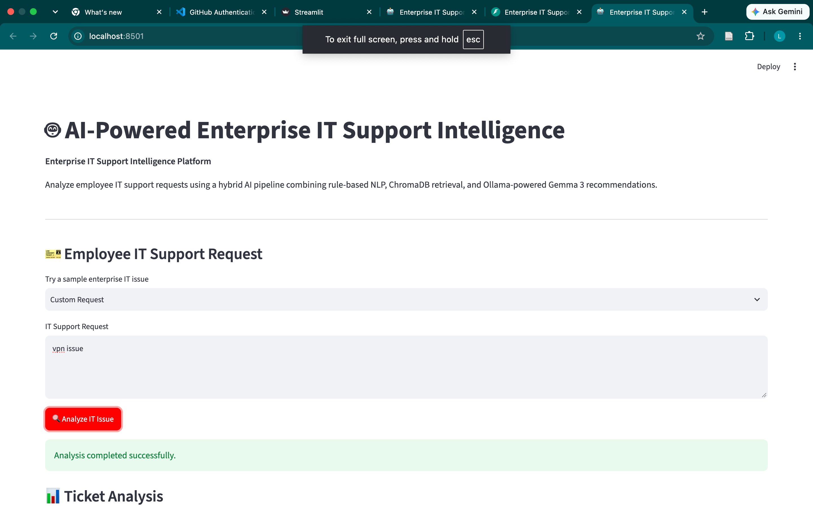
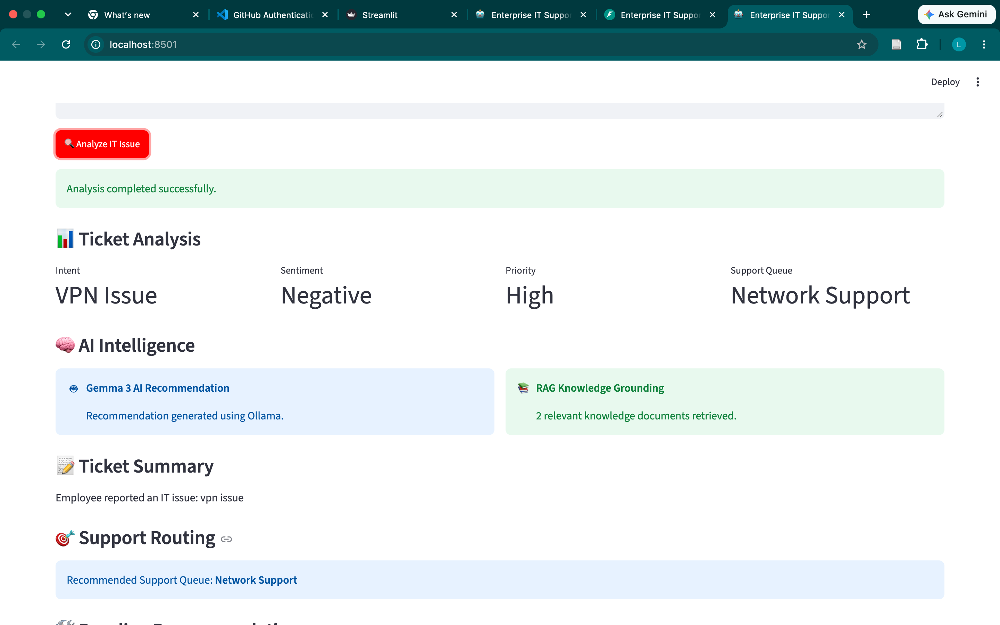
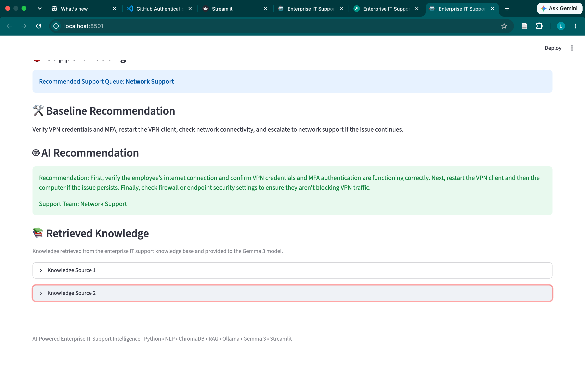
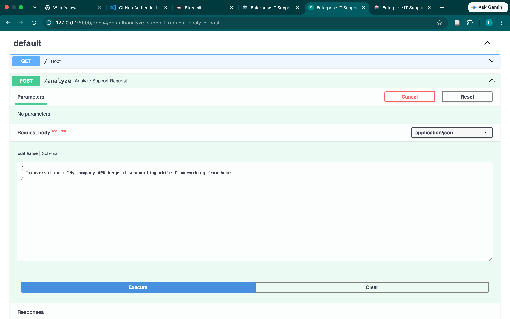
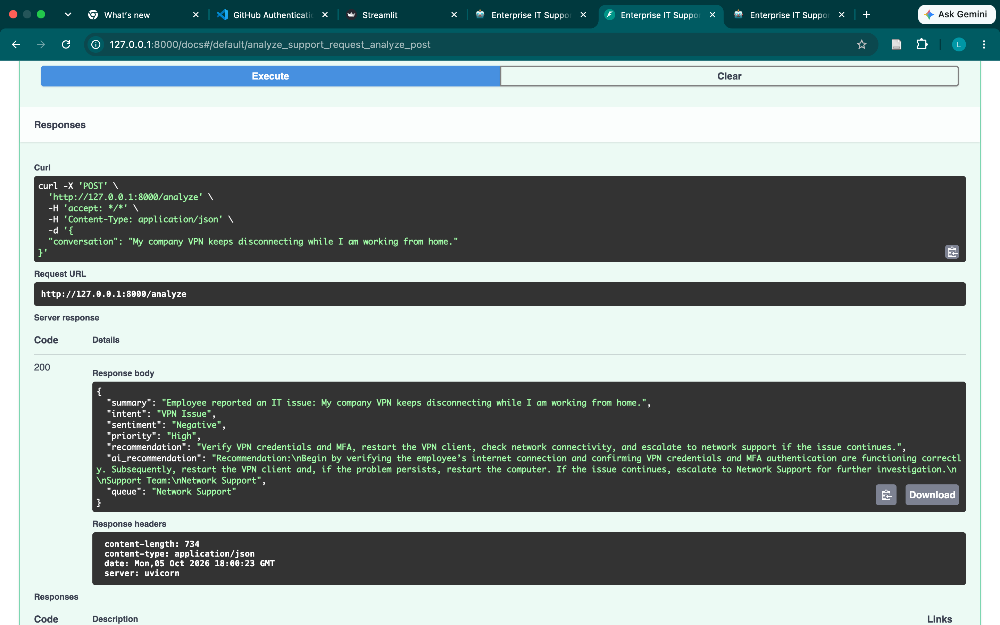

# AI-Powered Enterprise IT Support Intelligence

An end-to-end AI application that analyzes enterprise IT support requests, classifies issues, prioritizes tickets, retrieves relevant troubleshooting knowledge, and generates grounded recommendations using Retrieval-Augmented Generation (RAG) with Gemma 3.

## 🚀 Project Overview

Enterprise IT support teams receive large volumes of employee requests involving VPN connectivity, Wi-Fi, email, passwords, MFA, software installation, hardware, permissions, and performance issues.

This project demonstrates an AI-assisted support intelligence pipeline that converts an unstructured employee request into an actionable support analysis.

The system combines:

- Rule-based NLP classification
- Sentiment detection
- Priority classification
- Support queue routing
- ChromaDB vector retrieval
- Retrieval-Augmented Generation (RAG)
- Ollama + Gemma 3
- FastAPI REST API
- Streamlit dashboard
- Automated API testing

---

## 🏗️ Architecture

```text
Employee IT Support Request
            │
            ▼
    ┌─────────────────┐
    │   NLP Analysis  │
    │ Intent/Sentiment│
    │    /Priority    │
    └────────┬────────┘
             │
             ▼
    ┌─────────────────┐
    │ Baseline Rules  │
    │ Recommendation  │
    │ Support Routing │
    └────────┬────────┘
             │
             ▼
    ┌─────────────────┐
    │    ChromaDB     │
    │ Vector Retrieval │
    │   Knowledge Base │
    └────────┬────────┘
             │
             ▼
    ┌─────────────────┐
    │     Gemma 3     │
    │  Ollama / LLM   │
    │ Grounded RAG    │
    └────────┬────────┘
             │
             ▼
    ┌────────────────────────┐
    │ AI Support Recommendation│
    │ + Support Team Routing │
    └───────────┬────────────┘
                │
        ┌───────┴────────┐
        ▼                ▼
  Streamlit UI       FastAPI API
## 📸 Application Screenshots

### Streamlit Dashboard

The interactive dashboard analyzes employee IT support requests and provides intent, sentiment, priority, and support routing.



### RAG + Gemma 3 Recommendation

The system retrieves relevant IT knowledge from ChromaDB and uses Gemma 3 to generate a grounded recommendation.





### FastAPI REST API

The FastAPI service exposes the AI pipeline through a REST endpoint and returns structured analysis as JSON.



